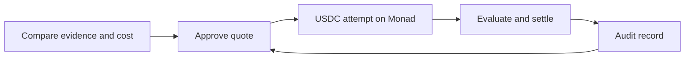

# LemmaX

**Spend less on AI work.**

Give an agent the evidence to decide whether a tool is worth buying, before it pays.

A cheap search that misses the source you need costs a second attempt or your own time, so a per-call price rarely tells an agent what the job will cost. A subscription can be the better choice if you already have unused allowance.

LemmaX puts the outcome, the evidence and the expected completion cost beside each offer. An agent can compare buying with its own alternative, choose a resource, or decide that buying makes no sense. When it buys, the price, success test, spending caps and refund terms are signed together.

The first working example is source retrieval: **one search, up to five cited sources, one defined outcome.** Two MCP offers run against the same frozen public benchmark. USDC settlement runs on Monad Testnet.

## Make the decision before the purchase

A directory entry is a versioned offer with a measurable result. Its evidence must match the offer version, task profile and success definition. Probability estimates carry their assumptions and uncertainty; missing evidence stays unknown.

LemmaX ranks comparable offers by expected completion cost, including the purchase, service charges, failure refunds and the buyer's fallback:

```text
expected completion cost
  = attempt overhead
  + p(success) × purchase price
  + p(failure) × (retained principal + fallback cost + loss)

expected saving = direct completion cost - expected completion cost
```

The [billing adapter](docs/Implementation.md#workload-billing-adapter) compares pay-as-you-go, new subscriptions and authorized, already-paid allowances, accounting for workload, reserved quota and overage. Live provider entitlement checks remain future work. Contribution accounting governs service availability without changing probabilities to favor a commission.

## A purchase with a result attached

For search, success means finding at least one labeled relevant source in the top five. The buyer locks **0.008 USDC**, including the search price and service reserves.

- **Hit:** the provider earns the 0.005 USDC search price. Execution and checking consume 0.0023 USDC; the unused 0.0007 returns to the buyer's credit.
- **Eligible miss:** the search price is refunded. The same disclosed service charges remain, returning 0.0057 USDC to buyer credit.
- **No valid verdict before the deadline:** the entire 0.008 USDC returns to buyer credit.

The buyer signs one USDC authorization bound to the complete quote. LemmaX relays it and pays the MON gas. Contract v3 pays accumulated credit at the owner's chosen bar, with a minimum of 0.01 USDC. Refused transfers preserve credit for retry; credit below the bar waits for accumulation or an owner-paid withdrawal.

The funding tool reports Monad's commit stages through MCP progress and waits for Verified before returning. The confirmed chain record carries the purchase into evaluation, settlement and the next buying decision.

An approved evaluator checks and signs the outcome. Detailed records stay offchain; encryption helpers and salted commitments are implemented. Public addresses, terms and amounts remain visible. LemmaX runs both checkers today, and the rulebook names who holds each key, so their judgment remains a trust assumption. The contract enforces authorization, caps, deadlines and allocations.

## The record changes the next decision

The trust loop checks each recorded settlement against a published, hash-pinned rulebook. Before another purchase, the buyer's guard checks the signed terms, the auditor's freshness and any blocking findings against the issuer or evaluator. A quote naming a flagged party is refused before the wallet authorizes payment.

Envio indexes rule compliance. Privy restricts signing to guard-approved quote digests. ERC-8004 carries agent identity and authorized settlement feedback. Reputation is separate from the evidence admitted to a probability estimate.

The complete loop has been rehearsed on a Monad Testnet fork using a local auditor and wallet-policy rehearsal. Hosted Envio, live Privy enforcement and ERC-8004 registration are pending. [Trust loop and its boundaries](docs/Trust-Loop.md).



## Measured so far

The paired SciFact benchmark measured **BM25 at 224/300 hits (74.67%)** and **TF-IDF at 230/300 (76.67%)**, using no model training or paid inference calls. A hit is a labeled relevant source in the top five. These are observed benchmark rates. They are not calibrated probabilities for an arbitrary company query.

The default assessment leaves probabilities and cost ranks unknown. Explicit scenarios estimate probabilities on 247 representative cases under a disclosed independence assumption and rank by declared costs. [Estimation scope](docs/Retrieval-and-MCP.md#probability-and-pricing-disclosure).

Three purchases ran on Monad Testnet with contract v2: a success, an eligible miss and a full timeout refund. Their events reconcile with the private records. [Live transactions and allocations](docs/Monad-Settlement-Path.md#live-run-on-monad-testnet).

Contract v3 is deployed and source-verified at [`0x2DA6DAE2731BDf030543AF18D8083d5de6a012a7`](https://testnet.monadvision.com/address/0x2DA6DAE2731BDf030543AF18D8083d5de6a012a7). Its automatic payouts passed local and fork checks. The public demo page and HTTP MCP transport are implemented and rehearsed on a fork; a hosted demo is still pending. [Evidence guide](docs/README.md#check-a-claim-against-its-record).

Status: Monad Testnet with public benchmark searches. There are no outside users, production savings or independent security review yet.

## Try the decision core

Use Node.js 22.15 or newer. No wallet, dataset or model API key is needed for these commands:

```sh
git clone https://github.com/4waan/LemmaX.git
cd LemmaX
npm ci --ignore-scripts
npm test
npm run demo
npm run demo:billing
npm run benchmark:verify
```

The examples use illustrative inputs. Benchmark verification checks the committed evidence without downloading the corpus.

To use the retrieval tools, [prepare the public SciFact corpus](docs/Retrieval-and-MCP.md#reproduce-locally), then launch `node scripts/mcp-server.mjs` from an MCP client with `LEMMAX_SCIFACT_DIR` set. The default server is read-only and offers discovery, assessment, retrieval, source reading and benchmark replay. Purchase tools require separate operator configuration.

## Build on LemmaX

The decision core can be used independently of settlement. Start with the [developer guide](CONTRIBUTING.md) for setup, module boundaries and checks, or the [documentation map](docs/README.md) for a reading order.

- [Assessment and billing API](docs/Implementation.md)
- [MCP tools and dataset setup](docs/Retrieval-and-MCP.md)
- [One paid unit and its acceptance test](docs/Paid-Unit.md)
- [Signed records, receipts and contract rules](docs/Attempt-and-Settlement.md)
- [Deployment, tariffs and operator roles](docs/Monad-Settlement-Path.md)
- [Architecture and privacy](docs/LemmaX-Architecture.md)

## Team and license

Aryan Singh Rathore and Awaan Mustafa Siddiqui, co-founders.

LemmaX is our third version of this idea, built over more than three weeks. LemmaXperiment set the contract and evaluation patterns: frozen terms, signature binding, replay controls and solvency checks. [Lemma](https://github.com/4waan/lemma) sold tested integrations to coding agents over x402 in USDC, refunded a failed test from a USDC bond and recorded each result onchain. LemmaX rebuilds that loop for Monad: the payment for each attempt is held in the attempt itself, and one settlement allocates it by the signed outcome. No source code was copied; the testnet operator keys and the `lemma_` tool names carry over, and our [review of both earlier projects](docs/research/LemmaX-Build-Readiness-and-Reuse.md) records what we kept.

LemmaX is [MIT licensed](LICENSE). Third-party data, packages and tools retain [their own terms](THIRD_PARTY.md). AI tools assisted in developing the project.
