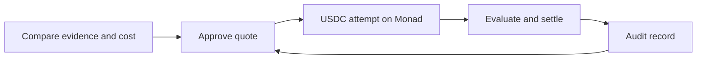

# LemmaX

**Your agent's wallet pays only for tools with a track record.**

Before it signs, LemmaX checks the tool's measured odds (a right source for 230 of 300 claims on a public benchmark), what an answer will cost against the agent's own way of getting it (0.052 USDC through LemmaX against 0.194 when the model reads the corpus itself, or an expected cost above the agent's own, about 0.0066 USDC against 0.0024, when its own pipeline is cheaper), and the public record of every settlement on Monad. The agent signs one USDC authorization whose nonce is the hash of the whole bill; LemmaX relays it, pays the MON gas and starts the search once Monad marks the payment Verified. A checker named on the bill signs the outcome, and one settlement splits the money: the provider earns the 0.005 USDC price on a hit, the price is credited back to the agent on a miss, and the checker's published fee is the same either way.

Every settlement is public, and the next purchase depends on it. An auditor checks each one against a hash-pinned rulebook. Before the wallet signs again, the buyer's guard confirms the auditor has seen the last settlement it knows of, and refuses any bill that names a flagged issuer or checker.

This is our third version of the loop ([how we got here](#team-and-license)), and the first two taught us what a chain has to provide:
- **Payment final inside one tool call.** Monad marks a block Verified about a second and a half after it is proposed, and its docs advise apps with significant offchain financial logic to wait for Verified.
- **A record fresh within seconds,** so the guard can read the last settlement before the next bill.
- **A settlement record for every attempt,** cheaply: about $0.0015 to $0.0021 of gas per settled attempt, measured on a fork at the prices our docs assume.
- **Agents that hold only USDC.** Circle's USDC on Monad lets one relayed signature fund an attempt. Running our earlier contract live showed that an agent with no MON cannot withdraw its credit, so contract v3 pays credit to the owner's wallet inside the settlement once it reaches 0.01 USDC.

Monad gives all four, and agent services already sell per call there in USDC.

On Monad Testnet, contract v2 has settled a hit, a miss and a timeout refund. [Contract v3](https://testnet.monadvision.com/address/0x2DA6DAE2731BDf030543AF18D8083d5de6a012a7) is deployed and source verified, and has run 19 attempts on testnet: 11 hits, 7 misses and a timeout refund. Claude Code bought two through both MCP servers, a hit ([0xfba6abd8](https://testnet.monadvision.com/tx/0xfba6abd880c80457740d209c93c752f5a942ce91145e3a482860ab37e6226851)) and a miss ([0x689bcddc](https://testnet.monadvision.com/tx/0x689bcddc0772baf129a3616a7ac24597ecea5859cad061fc74db43469c70805a)); the page's buy flow made thirteen (twelve in the [record](verification/live-runs-testnet.json), plus the hosted page's first Envio-gated purchase, [0x708c4cbc](https://testnet.monadvision.com/tx/0x708c4cbcb7cd227632edac133e13a66d46d3e0f555539100b39a0775e1fb1220)); the trust loop ran the other four, including a canary checker that overcharged on purpose: Envio flagged it, and the guard refused the next bill naming it before the wallet signed ([report](verification/trust-loop-testnet.json)). For the last ten, the buyer's guard read the hosted Envio auditor before the wallet signed, and the page waited for Envio to index each settlement before showing its receipt. Settlements paid credit out automatically once it reached 0.01 USDC, including 0.0128 and 0.0135 USDC to an agent wallet that holds no MON. Envio agrees with the local auditor on all 19 contract v3 attempts and with the recorded outcomes of the three v2 purchases ([check](verification/auditor-check-testnet.json)). The Privy wallet policy passed all 13 of its allow and deny checks on a throwaway Privy wallet ([report](verification/privy-kill-test.json)). LemmaX's four ERC-8004 agents are registered, and feedback from all 19 settled attempts is published in two batches and marked valid by Envio, including the canary checker's overcharge, now a permanent record on its ERC-8004 identity ([record](verification/reputation-testnet.json)); the buyer's own Privy wallet comes next. [How the trust loop works](docs/Trust-Loop.md).

## Make the decision before the purchase

A directory entry is a versioned offer with a measurable result. Its evidence must match the offer version, task profile and success definition. Probability estimates carry their assumptions and uncertainty; missing evidence stays unknown.

LemmaX ranks comparable offers by expected completion cost, including the purchase, service charges, failure refunds and the buyer's fallback:

```text
expected completion cost
  = attempt overhead
  + p(success) × purchase price
  + p(failure) × (retained principal + fallback cost + loss)

expected saving = direct completion cost - expected completion cost
```

The [billing adapter](docs/Implementation.md#workload-billing-adapter) compares pay-as-you-go, new subscriptions and authorized, already-paid allowances, accounting for workload, reserved quota and overage. Live provider entitlement checks remain future work. Contribution accounting governs service availability without changing probabilities to favor a commission.

## A purchase with a result attached

For search, success means finding at least one labeled relevant source in the top five. The buyer locks **0.008 USDC**, including the search price and service reserves.

- **Hit:** the provider earns the 0.005 USDC search price. Execution and checking consume 0.0023 USDC; the unused 0.0007 returns to the buyer's credit.
- **Eligible miss:** the search price is refunded. The same disclosed service charges remain, returning 0.0057 USDC to buyer credit.
- **No valid verdict before the deadline:** the entire 0.008 USDC returns to buyer credit.

The buyer signs one USDC authorization bound to the complete quote. LemmaX relays it and pays the MON gas. Contract v3 pays accumulated credit at the owner's chosen bar, with a minimum of 0.01 USDC. Refused transfers preserve credit for retry; credit below the bar waits for accumulation or an owner-paid withdrawal.

The funding tool reports Monad's commit stages through MCP progress and waits for Verified before returning. The confirmed chain record carries the purchase into evaluation, settlement and the next buying decision.

An approved evaluator checks and signs the outcome. Detailed records stay offchain; encryption helpers and salted commitments are implemented. Public addresses, terms and amounts remain visible. LemmaX runs both checkers today, and the rulebook names who holds each key, so their judgment remains a trust assumption. The contract enforces authorization, caps, deadlines and allocations.

## The record changes the next decision

The trust loop checks each recorded settlement against a published, hash-pinned rulebook. Before another purchase, the buyer's guard checks the signed terms, the auditor's freshness and any blocking findings against the issuer or evaluator. A quote naming a flagged party is refused before the wallet authorizes payment.

Envio indexes rule compliance, and the guard reads it before every signature. Privy restricts signing to guard-approved quote digests: the policy passed its kill test, and until the buyer's own Privy wallet is created, a local signer applies the same rule. ERC-8004 carries agent identity and feedback from settled attempts only: LemmaX's four agents are registered on testnet, and Envio checks each feedback record against the settlements ([record](verification/reputation-testnet.json)). Reputation is separate from the evidence admitted to a probability estimate.

The complete loop has been rehearsed on a Monad Testnet fork. On testnet, the hosted Envio auditor is live, gates the page's purchases and caught the canary checker's overcharge ([GraphQL endpoint](https://indexer.dev.hyperindex.xyz/7c5b0aa/v1/graphql), [check](verification/auditor-check-testnet.json)), the Privy policy passed its kill test ([report](verification/privy-kill-test.json)), and the four ERC-8004 agents carry published feedback ([record](verification/reputation-testnet.json)); the buyer's own Privy wallet is pending. [Trust loop and its boundaries](docs/Trust-Loop.md).

Next, the ledger becomes the odds. Each bill will commit to the hit rate it showed, so every settlement on Monad scores the forecast that sold it. Further out, search services that already sell per call on Monad could sell attempts with their own price, odds and refund terms, backed by their settled history; independent checkers would carry public conduct records, and every buyer's guard reading the same index would refuse the next bill that names a checker caught overbilling. The assessment library already accepts settled-attempt evidence. Getting there needs chain data fed into it, a public identity per offer and an issuer registry.



## Measured so far

The paired SciFact benchmark measured **BM25 at 224/300 hits (74.67%)** and **TF-IDF at 230/300 (76.67%)**, using no model training or paid inference calls. A hit is a labeled relevant source in the top five. These are observed benchmark rates. They are not calibrated probabilities for an arbitrary company query.

The default assessment leaves probabilities and cost ranks unknown. Explicit scenarios estimate probabilities on 247 representative cases under a disclosed independence assumption and rank by declared costs. [Estimation scope](docs/Retrieval-and-MCP.md#probability-and-pricing-disclosure).

Three purchases ran on Monad Testnet with contract v2: a success, an eligible miss and a full timeout refund. Their events reconcile with the private records. [Live transactions and allocations](docs/Monad-Settlement-Path.md#live-run-on-monad-testnet).

Contract v3 is deployed and source-verified at [`0x2DA6DAE2731BDf030543AF18D8083d5de6a012a7`](https://testnet.monadvision.com/address/0x2DA6DAE2731BDf030543AF18D8083d5de6a012a7). On testnet, Claude Code bought through both MCP servers, and the page server bought through its own API with a demonstration buyer wallet. Across the page's twelve recorded runs, Monad's commit-state stream reported Verified between 1.23 and 1.50 seconds after relay, and every automatic payout ran inside its settlement. The page runs at [lemmax-production.up.railway.app](https://lemmax-production.up.railway.app). [Evidence guide](docs/README.md#check-a-claim-against-its-record).

Status: Monad Testnet with public benchmark searches. There are no outside users, production savings or independent security review yet.

## Try the decision core

Use Node.js 22.15 or newer. No wallet, dataset or model API key is needed for these commands:

```sh
git clone https://github.com/4waan/LemmaX.git
cd LemmaX
npm ci --ignore-scripts
npm test
npm run demo
npm run demo:billing
npm run benchmark:verify
```

The examples use illustrative inputs. Benchmark verification checks the committed evidence without downloading the corpus.

To use the retrieval tools, [prepare the public SciFact corpus](docs/Retrieval-and-MCP.md#reproduce-locally), then launch `node scripts/mcp-server.mjs` from an MCP client with `LEMMAX_SCIFACT_DIR` set. The default server is read-only and offers discovery, assessment, retrieval, source reading and benchmark replay. Purchase tools require separate operator configuration.

## Use it from Claude Code

An agent buys through two MCP servers: LemmaX, which serves offers, the assessment, quotes, funding, delivery and the audit, and the agent's own wallet, which signs only bills the buyer's guard has cleared. The LemmaX server never reads the agent's key; only the wallet server signs. With the operator's and the buyer's variables in the environment ([which ones](docs/Retrieval-and-MCP.md#the-agents-wallet)):

```sh
claude mcp add --transport stdio lemmax -- node scripts/mcp-server.mjs
claude mcp add --transport stdio wallet -- node scripts/wallet-server.mjs
```

Then ask for a source and a budget. The agent calls `lemma_list_offers` and `lemma_assess` to see the odds and the expected cost against its own fallback, `lemma_quote_attempt` for one bill, `wallet_sign_bill` to sign it, `lemma_fund_attempt`, which returns once Monad marks the payment Verified, `lemma_deliver_attempt` for the sources, the checker's verdict and the settlement, and `lemma_verify_attempt` to check that settlement against the rulebook. The page serves the read-only tools at `/mcp`, so `claude mcp add --transport http lemmax https://lemmax-production.up.railway.app/mcp` connects them without any keys.

## Build on LemmaX

The decision core can be used independently of settlement. Start with the [developer guide](CONTRIBUTING.md) for setup, module boundaries and checks, or the [documentation map](docs/README.md) for a reading order.

- [Assessment and billing API](docs/Implementation.md)
- [MCP tools and dataset setup](docs/Retrieval-and-MCP.md)
- [One paid unit and its acceptance test](docs/Paid-Unit.md)
- [Signed records, receipts and contract rules](docs/Attempt-and-Settlement.md)
- [Deployment, tariffs and operator roles](docs/Monad-Settlement-Path.md)
- [Architecture and privacy](docs/LemmaX-Architecture.md)

## Team and license

Aryan Singh Rathore and Awaan Mustafa Siddiqui, co-founders.

LemmaX is the third version of an idea we have worked on for more than three weeks: LemmaXperiment, then Lemma, now LemmaX. LemmaXperiment set the contract and evaluation patterns we still use: frozen terms, signature binding, replay controls, exact allocation and solvency checks. In [Lemma](https://github.com/4waan/lemma), a coding agent bought a tested release twice over x402 on Arbitrum Sepolia; one purchase passed its tests, and the other failed and was refunded from a separate USDC bond, with each result recorded onchain. LemmaX rebuilds that loop for Monad: the buyer's money stays inside the attempt until one settlement allocates it by the signed outcome, the agent sees a measured hit rate before it pays, and a guard reads the public record before the wallet signs. No source code was copied; the testnet operator keys and the `lemma_` tool prefix carry over, and our [pre-build review of both earlier projects](docs/research/LemmaX-Build-Readiness-and-Reuse.md) records which patterns we kept.

LemmaX is [MIT licensed](LICENSE). Third-party data, packages and tools retain [their own terms](THIRD_PARTY.md). AI tools assisted in developing the project.
