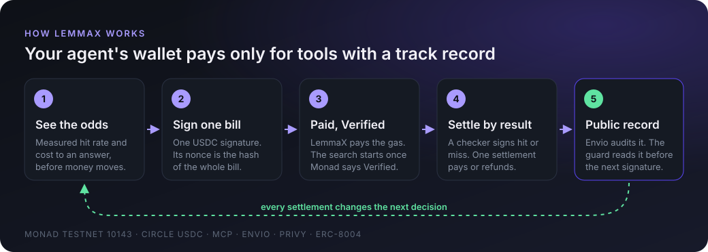
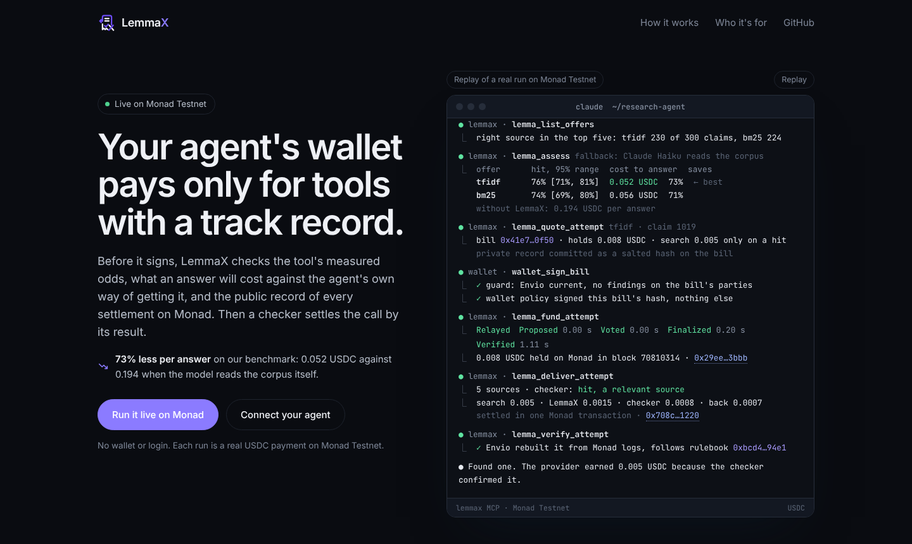
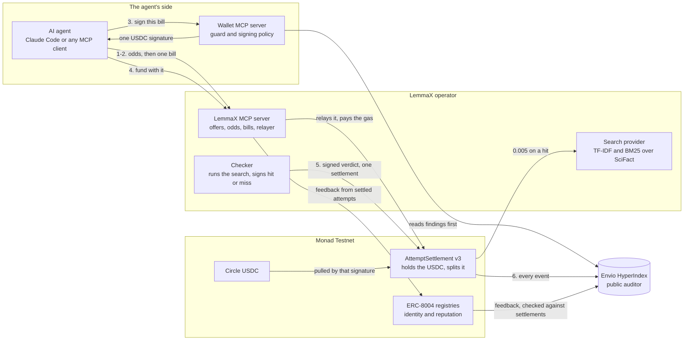
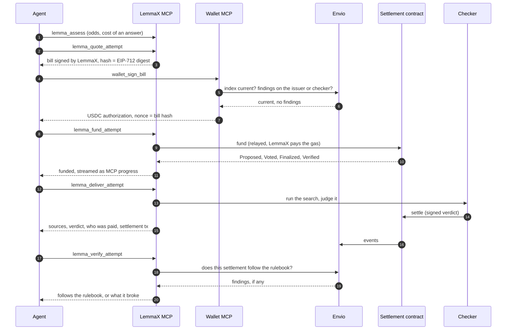

<div align="center">

<picture>
  <source media="(prefers-color-scheme: dark)" srcset="docs/brand/lemmax-logo-dark.png">
  
</picture>

### Your agent's wallet pays only for tools with a track record.

Before an AI agent pays for a tool, LemmaX shows how often that tool finds a right answer and what an answer is likely to cost. The agent's wallet then signs one USDC payment, tied to one bill, on Monad. A checker judges the result: the tool's provider is paid for a hit, and the search price comes back on a miss. Every settlement lands in a public record, and the wallet checks that record before it signs again.

[](https://lemmax-production.up.railway.app)

**[How it works](#how-it-works)** · **[Architecture](#architecture)** · **[Caught on testnet](#caught-on-testnet-a-checker-that-overcharged)** · **[Privy](#a-privy-wallet-that-can-sign-only-approved-bills)** · **[Verify it yourself](#verify-it-yourself)** · **[Connect your agent](#connect-your-agent)** · **[Where it stands](#where-it-stands)**

[](https://testnet.monadvision.com/address/0x2DA6DAE2731BDf030543AF18D8083d5de6a012a7)
[](https://testnet.monadvision.com/address/0x534b2f3A21130d7a60830c2Df862319e593943A3)
[](https://indexer.dev.hyperindex.xyz/7c5b0aa/v1/graphql)
[](#a-privy-wallet-that-can-sign-only-approved-bills)
[](verification/reputation-testnet.json)
[](#connect-your-agent)
[](https://github.com/4waan/LemmaX/actions/workflows/checks.yml)
[](LICENSE)



</div>

[](https://lemmax-production.up.railway.app)

**[Open the live page →](https://lemmax-production.up.railway.app)** It replays a real purchase on Monad Testnet, shown as a Claude Code session. Its **Run it live on Monad** button makes a new purchase with a demo wallet on our server, so you need no wallet and no login. Everything runs on Monad Testnet, a public test network, with test USDC.

## Agents pay for tools blind

AI agents already pay per call for search and data. Three things go wrong:

1. **A miss is billed like a hit.** Perplexity's Search API bills each completed request, not each useful result, and Claude's web search counts each search as one use however many results it returns. An agent pays the same per-search fee for a search that found nothing relevant.
2. **The agent cannot see the odds.** It has no measured hit rate for the tool, and no way to tell whether buying beats doing the work itself.
3. **A wallet signs whatever it is asked.** Spend limits cap the damage, but they do not judge the tool or the party sending the bill.

**LemmaX gives the wallet judgment.** It charges the search price only for an answer, shows the odds before any money moves, and refuses the next bill when the public record shows that the party sending it, or the checker named on it, broke the published rules.

<details>
<summary><strong>New to these words? Read this first</strong></summary>

| Word | What it means here |
|---|---|
| **Monad** | A fast blockchain that runs Ethereum-style smart contracts. LemmaX runs on Monad Testnet, its public test network. |
| **MON and gas** | MON is Monad's own coin. Every transaction pays a small fee, called gas, in MON. LemmaX pays it, so the agent needs none. |
| **USDC** | Circle's dollar stablecoin. Agents pay in it. On testnet it is free test money. |
| **MCP** | The Model Context Protocol: the standard way an AI agent such as Claude Code calls outside tools. |
| **Bill** | LemmaX's signed quote for one attempt: the price, who is paid what on a hit or a miss, the checker and the deadlines. Its EIP-712 hash is a fingerprint of every term. |
| **Checker** | The party named on the bill that judges the search and sends the settlement. |
| **Guard** | A small rule check inside the agent's wallet that must approve a bill before the wallet signs. |
| **Rulebook** | The published fees, deadlines, payees and approved checkers. Its hash is pinned in the guard, so an edited rulebook would be noticed. |
| **Envio** | Envio HyperIndex, a public index that rebuilds every LemmaX settlement from Monad and checks it against the rulebook. |
| **Privy** | Privy's server wallets, whose policies decide what a wallet may sign. |
| **ERC-8004** | A standard for AI agent identity and reputation on chain. |

</details>

## How it works

**What is on sale today:** two keyword search engines, TF-IDF and BM25, over SciFact, a public set of scientific claims whose relevant research abstracts are already labeled. A **hit** means a labeled relevant source in the top five results. We start with a benchmark because a refund needs a known right answer.

An agent buys through two MCP servers: **LemmaX**, which lists the offers and runs the purchase, and **the agent's own wallet**, which holds the agent's private key and signs. LemmaX never sees that key.

| | Step | What happens | Tool |
|---|---|---|---|
| 1 | **See the odds** | LemmaX shows each offer's hit rate on the benchmark (230 of 300 for TF-IDF). Under a stated independence assumption, it adds a 95% range and the expected cost of ending up with an answer: the purchase, plus the agent's own fallback if the search misses, compared with using that fallback alone. | `lemma_list_offers`, `lemma_assess` |
| 2 | **Get one bill** | LemmaX signs a bill for one attempt: the price, the payees, the most each fee can be, the checker and the deadlines. | `lemma_quote_attempt` |
| 3 | **Check, then sign** | The guard checks the bill against the rulebook, then reads the public Envio index: is it current, and has the bill's issuer or checker been flagged? Only then does the wallet sign one USDC authorization (EIP-3009) whose nonce is the bill's hash, so the signature cannot pay for any other terms. | `wallet_sign_bill` |
| 4 | **Pay, wait for Verified** | LemmaX submits the signature to Monad and pays the gas. The USDC moves into the settlement contract, held for this attempt only. The tool reports each of Monad's commit states (Proposed, Voted, Finalized, Verified) as MCP progress and returns at **Verified**, the last one, which Monad advises waiting for before acting on a payment. | `lemma_fund_attempt` |
| 5 | **Search, judge, settle** | The checker runs the search, signs hit or miss, and one transaction splits the money by that verdict. | `lemma_deliver_attempt` |
| 6 | **Audit** | Envio rebuilds the settlement from public Monad data and checks it against the rulebook. A breach becomes a public finding that every guard reads before the next signature. | `lemma_verify_attempt` |

### Where the money goes

The agent locks **0.008 USDC** for one attempt: the 0.005 search price, plus caps of 0.002 for LemmaX's execution (relaying the payment and running the attempt) and 0.001 for checking the result. The published fees are lower than the caps, and whatever is not charged comes back.

| Outcome | Search provider | LemmaX (execution) | Checker (judges it) | Back to the agent |
|---|---:|---:|---:|---:|
| **Hit**: a relevant source in the top five | 0.005 | 0.0015 | 0.0008 | 0.0007 |
| **Miss**: none in the top five | 0 | 0.0015 | 0.0008 | **0.0057** |
| **No verdict by the deadline** | 0 | 0 | 0 | **0.008** |

Under the rulebook, the two fees are the same on a hit or a miss, and the same whichever offer ranks first. The contract caps them, and the auditor flags any charge above the published fee. A timeout refund is one call that anyone may send after the deadline.

Money that comes back is first held as credit in the contract. Withdrawing it yourself would take a transaction, and transactions cost MON. Instead, once the agent's credit reaches its payout bar (0.01 USDC unless the owner sets a higher one), the settlement that takes it over the bar pays it to the agent's wallet, **even a wallet that holds no MON**. Smaller credit waits for the next settlement.

## Architecture

LemmaX splits the job so that **no single party both holds the money and decides where it goes**. The agent's key never leaves its wallet, the contract holds the USDC, a checker signs the verdict, and a public index audits every settlement.



| Part | What it does | Who runs it | Code |
|---|---|---|---|
| **Wallet MCP server** | Holds the agent's key. Signs one thing only: the USDC authorization for a bill the guard approved. | The agent's owner | [`src/wallet-mcp.mjs`](src/wallet-mcp.mjs), [`scripts/wallet-server.mjs`](scripts/wallet-server.mjs), [`src/buyer-wallet.mjs`](src/buyer-wallet.mjs) |
| **Buyer's guard** | Before every signature, checks the bill against the rulebook, that the auditor is within 30 blocks of Monad and has indexed the last settlement this wallet knows of, and that neither the bill's issuer nor its checker has a blocking finding. | Inside the wallet | [`src/guard.mjs`](src/guard.mjs), [`src/audit.mjs`](src/audit.mjs) |
| **Signing policy** | Lets the wallet sign only a USDC authorization to the settlement contract, within the bill's total, whose nonce is a guard-approved bill hash. [More below](#a-privy-wallet-that-can-sign-only-approved-bills). | A Privy policy, tested 13 of 13. Until the agent's own Privy wallet is set up, a local signer applies the same rule. | [`src/privy-buyer.mjs`](src/privy-buyer.mjs) |
| **LemmaX MCP server** | Lists offers, computes the odds and the cost of an answer, signs bills, relays funding and streams Monad's commit states. Read-only unless the operator's keys are set. | LemmaX | [`scripts/mcp-server.mjs`](scripts/mcp-server.mjs), [`src/mcp.mjs`](src/mcp.mjs), [`src/directory.mjs`](src/directory.mjs), [`src/purchase.mjs`](src/purchase.mjs), [`src/issuer.mjs`](src/issuer.mjs), [`src/operator.mjs`](src/operator.mjs) |
| **Assessment library** | Turns measured hits and misses into a hit rate with a 95% range (a Beta posterior) and an expected cost against the agent's fallback. Says "unknown" when the evidence cannot support a number. | Anyone, offline | [`src/assessment.mjs`](src/assessment.mjs), [`src/beta.mjs`](src/beta.mjs), [`src/billing.mjs`](src/billing.mjs) |
| **Checker** | Runs the bought search, signs whether a relevant source came back, and sends the settlement. | LemmaX today | [`src/evaluator.mjs`](src/evaluator.mjs), [`src/delivery.mjs`](src/delivery.mjs) |
| **Search provider** | Owns the search tool on sale and earns the 0.005 USDC price on a hit. | LemmaX today (ERC-8004 agent 2299) | [`src/retrieval.mjs`](src/retrieval.mjs), [`registrations/provider.json`](registrations/provider.json) |
| **Settlement contract** | Accepts only bills LemmaX signed, pulls the USDC with one signature, holds it inside the attempt, checks the checker's signature, the fee caps and the deadlines, then splits the money and pays out credit at the bar. No admin can move the money. | Monad | [`contracts/AttemptSettlement.sol`](contracts/AttemptSettlement.sol) |
| **Public auditor** | The contract only sees each bill's caps. The auditor checks what the contract cannot: the published fees, the deadlines, the payees and the approved checkers. It also validates ERC-8004 feedback against real settlements. A local auditor applies the same rules over RPC, so anyone can cross-check Envio. | Envio HyperIndex, open GraphQL | [`indexer/`](indexer/), [`rulebook/lemmax-rulebook-v1.json`](rulebook/lemmax-rulebook-v1.json), [`src/local-audit.mjs`](src/local-audit.mjs) |
| **Reputation** | Four ERC-8004 agents: the LemmaX Directory (the list of offers), the regular checker, Checker B (a canary, see below) and the search provider. Feedback is written only from settled attempts. | LemmaX publishes in batches, Envio validates | [`src/erc8004.mjs`](src/erc8004.mjs), [`src/reputation.mjs`](src/reputation.mjs) |
| **Live page** | A web page and a read-only MCP endpoint at `/mcp`. Its button runs the same purchase with a demo wallet on our server. | Railway | [`web/server.mjs`](web/server.mjs), [`web/live.mjs`](web/live.mjs), [`web/public/`](web/public/) |

<details>
<summary><strong>One purchase, message by message</strong></summary>



</details>

### Who has to be trusted, and for what

- **The contract enforces the bill:** that LemmaX signed it, that the USDC comes from the agent's authorization for exactly this bill, the fee caps, the deadlines and the checker's signature. It splits the money by the verdict.
- **The guard and the signing policy enforce what the wallet signs.** A stale auditor, or a bill naming a flagged issuer or checker, means no signature.
- **The auditor enforces the published fees.** Whether a fee matches the rulebook is checked after settlement, from public data, and a breach blocks the next bill.
- **The checker is trusted** to judge the search honestly. Its rulebook is public, its fee does not depend on the verdict, and an overcharge becomes a public finding as soon as it settles. LemmaX runs the provider and both of today's checkers, and the rulebook says so.

## Caught on testnet: a checker that overcharged

The trust loop (settle, audit, then let the record decide the next signature) is not a promise. We ran it on Monad Testnet with **Checker B**, a test checker LemmaX runs, set up to overcharge once on purpose so anyone can watch the auditor catch it.

1. Checker B signed a verdict charging 0.001 USDC for checking, above the published 0.0008, and the attempt settled on it ([settlement](https://testnet.monadvision.com/tx/0xe3f60ced61c8c4d85d4c1d8bfd148654ce04893935b680b41e033f234bcd0301); the regular checker's wallet sent the transaction because Checker B holds no MON). **The contract accepted it**, because the bill allows up to 0.001 for checking and the contract enforces only that cap.
2. Envio rebuilt it from Monad and recorded a blocking `above_tariff` finding against Checker B ([auditor check](verification/auditor-check-testnet.json)).
3. The next bill naming Checker B was refused by the guard before the wallet signed: `evaluator_flagged`. Nothing was signed and nothing was sent ([report](verification/trust-loop-testnet.json)).
4. In a later feedback batch, LemmaX published the overcharge to Checker B's ERC-8004 identity, **agent 2298: 0 of 1 settled attempts conforming**, and Envio marked that feedback valid ([feedback](https://testnet.monadvision.com/tx/0x48f909ccf45a6d1b0d0b312bb09e10eebf46b3a556a309882e40f8b70fdb6a39)).

The finding stays on the public index, so every guard refuses every new bill that names Checker B. The live server keeps that check behind its trick endpoint (`POST /api/trick` with `flagged_checker`).

## A Privy wallet that can sign only approved bills

Spend limits answer "how much may this wallet spend". LemmaX uses **Privy's policy engine** to answer a sharper question: **which exact bill may it pay**. The agent's wallet is a Privy server wallet with a single ALLOW rule, enforced by Privy outside the agent's process:

```text
Rule: "Pay only guard-approved LemmaX quotes"        everything else: denied by default
  method             eth_signTypedData_v4  (USDC ReceiveWithAuthorization)
  chainId            = 10143, Monad Testnet
  verifyingContract  = Circle USDC
  to                 = the LemmaX settlement contract
  value              <= the bill's total
  nonce              in the guard's condition set
```

The nonce is the bill's EIP-712 hash, so membership in the condition set pins every term of the bill: price, payees, checker and deadlines. **The guard decides, and Privy enforces.**

Three P-256 authorization keys split the power, so a leaked agent key cannot change the rule or approve a bill:

| Key | Who holds it | What it can do |
|---|---|---|
| **Principal** | The wallet's owner, kept offline | Owns the wallet and the policy |
| **Agent** | The AI agent | Signs, but only what the policy allows |
| **Guard** | The buyer's guard | Adds and removes approved bill hashes. Neither the agent nor LemmaX holds it. |

**Kill test against Privy's live API: 13 of 13.** On a throwaway Privy wallet, with keys held only in memory ([report](verification/privy-kill-test.json), run it with `npm run privy:kill-test`):

| Request to the Privy wallet | Expected | Privy's answer |
|---|---|---|
| A test USDC authorization whose nonce the guard approved | allowed | ✓ signed in 222 ms |
| Its signature: normalized, and recovers to the wallet | allowed | ✓ |
| A nonce the guard never approved | refused | ✗ `policy_violation` |
| More than the bill's total | refused | ✗ `policy_violation` |
| Paying anyone but the settlement contract | refused | ✗ `policy_violation` |
| A plain USDC `TransferWithAuthorization` to anyone | refused | ✗ `policy_violation` |
| `personal_sign` | refused | ✗ `policy_violation` |
| secp256k1 hash signing | refused | ✗ `policy_violation` |
| Raw hash signing | refused | ✗ `invalid_data` |
| Exporting the private key | refused | ✗ 401 |
| An EIP-7702 delegation | refused | ✗ `policy_violation` |
| The agent adding its own nonce to the guard's set | refused | ✗ 401 |
| The approved authorization after the guard removes its nonce | refused | ✗ `policy_violation` |

The integration is complete code, not a mock: the policy and the condition-set client ([`src/privy-buyer.mjs`](src/privy-buyer.mjs), which signs condition-set writes with the guard's authorization key over Privy's REST API), the wallet that picks Privy when configured ([`src/buyer-wallet.mjs`](src/buyer-wallet.mjs)), the kill test ([`scripts/privy-kill-test.mjs`](scripts/privy-kill-test.mjs)) and a one-command setup for the agent's own wallet ([`scripts/privy-setup.mjs`](scripts/privy-setup.mjs), `npm run privy:setup`). The purchases recorded below were signed by a local signer that applies the same rule in-process; moving the agent onto its own Privy wallet is our next step.

## What makes it different

Pay-per-call APIs charge for the call. Spend limits cap how much a wallet can lose. LemmaX adds judgment before, during and after the payment:

- **Odds before money.** The agent sees the measured hit rate before it pays and, under a stated independence assumption, a 95% range and the expected cost of an answer.
- **It shows when buying loses.** The expected cost depends on the agent's fallback. If the fallback is a model reading the whole corpus (an estimated 0.194 USDC), buying a search first is expected to cost about **0.052 USDC an answer**. If the fallback is the agent's own pipeline at 0.0024 USDC, buying is expected to cost about 0.0066, the saving comes out negative, and the agent can decide not to buy.
- **The search price only for a result.** The 0.005 USDC price is paid on a hit and credited back on a miss in the same settlement. The 0.0023 in fees is the same either way.
- **No reason to steer.** Both offers carry the same fees, and the ranking orders them by the agent's expected cost.
- **One signature is the whole bill.** The USDC authorization's nonce is the bill's EIP-712 hash, so the signature cannot be reused for different terms.
- **No gas token needed.** LemmaX relays and pays the gas. Once the agent's credit reaches 0.01 USDC, a settlement pays it to the agent's wallet, even one with no MON.
- **Final inside one tool call.** The funding tool streams Monad's commit states as MCP progress and returns at Verified, and the agent starts the search only after that.
- **The record decides the next signature.** The guard refuses to sign while the index is more than 30 blocks behind Monad, before it has processed the settlement the agent reports from its last purchase, or when the bill's issuer or checker has a blocking finding.
- **Rules anyone can check.** The rulebook is public and hash-pinned, and Envio checks every settlement against it using only public Monad data.
- **Reputation from settled money only.** ERC-8004 feedback comes only from settled attempts, and Envio validates each record against the settlements it counts.
- **Two locks on signing.** The LemmaX server never holds the agent's key. The guard is one lock. The Privy policy is the second: on a Privy wallet, even an agent that skips the guard cannot sign an unapproved bill.

## Built with

| What | Its job in LemmaX |
|---|---|
| **Monad Testnet** (chain 10143) | Holds each attempt's USDC until one settlement splits it. Its Verified state tells the funding tool when the search may start. [Settlement path](docs/Monad-Settlement-Path.md) |
| **Circle USDC** with EIP-3009 | One signed `receiveWithAuthorization` funds an attempt, so the agent holds only USDC. |
| **EIP-712** typed data | The bill, the checker's verdict and the payment authorization are typed, signed and checked on chain. |
| **Envio HyperIndex** | The public auditor: rebuilds every attempt, applies the rulebook, records findings and validates ERC-8004 feedback. The guard reads it before every signature. [Indexer](indexer/) |
| **Privy** server wallets and policies | The second lock: a policy that lets the wallet sign only guard-approved bills, with a guard-owned condition set and three authorization keys. [Section](#a-privy-wallet-that-can-sign-only-approved-bills) |
| **ERC-8004** identity and reputation | Four registered agents, with feedback only from settled attempts. [Record](verification/reputation-testnet.json) |
| **Model Context Protocol** (official TypeScript SDK) | Two servers, LemmaX and the wallet, usable from Claude Code or any MCP client. Funding streams commit states as MCP progress. [Tools](docs/Retrieval-and-MCP.md) |
| **OpenZeppelin Contracts** | EIP-712, ECDSA and reentrancy protection in the settlement contract. |
| **viem**, **zod**, **solc 0.8.37** | Chain reads and writes with EIP-712 hashing and signing, MCP tool input schemas, and the pinned Solidity compiler. |
| **Foundry's anvil** | Runs the contract's whole lifecycle locally under Monad's execution rules. |
| **SciFact** benchmark | Public claims with labeled sources, so the checker judges each search against a known right answer, and anyone who knows the case can replay it. [Terms](THIRD_PARTY.md) |
| **Railway** | Hosts the live page and its read-only MCP endpoint. |

## Verify it yourself

Every purchase and settlement below ran on Monad Testnet with test USDC, and you can open each one on MonadVision, Monad Testnet's block explorer. The contract checks ran on a local chain and a local fork; the Privy and benchmark results are reports in this repo.

**Two live purchases from the page, a hit and a miss, every step on Monad**

| Step | A hit (SciFact claim 1019) | A miss (SciFact claim 1049) |
|---|---|---|
| The agent's USDC moved into the attempt, relayed by LemmaX | [`0xd2653cc5…6d0a`](https://testnet.monadvision.com/tx/0xd2653cc5549c2663f1a47913b1d88175a80144879c962e1ee0c6d51305ad6d0a) | [`0x19e40f7a…d85d`](https://testnet.monadvision.com/tx/0x19e40f7a5a977526b274e373a2c05cb0eae0e8b19b2ed11f731f94467bded85d) |
| Monad marked the payment Verified | 1.34 s after relay | 1.43 s after relay |
| Checker's verdict | a relevant source in the top five | no relevant source in the top five |
| One settlement split the money | [`0xaced4885…df12`](https://testnet.monadvision.com/tx/0xaced488554853be54ade86a2257074abbea55d1ec6c62d62a035042b3a54df12) | [`0xaf7abbd3…d04a`](https://testnet.monadvision.com/tx/0xaf7abbd372aba354476833ac961eee87238e752ac2cd3270fdb87ed0301dd04a) |
| What the agent got back | 0.0007 USDC, added to its credit | 0.0057 USDC, which took its credit to 0.0135, paid out in the same settlement to a wallet with no MON |

**Contracts and endpoints**

| | Address or link |
|---|---|
| Settlement contract v3 (current, source verified) | [`0x2DA6DAE2731BDf030543AF18D8083d5de6a012a7`](https://testnet.monadvision.com/address/0x2DA6DAE2731BDf030543AF18D8083d5de6a012a7) |
| Settlement contract v2 (the earlier version, three attempts) | [`0xfb59487E973C883E3fe4301238D485f7B248fA7f`](https://testnet.monadvision.com/address/0xfb59487E973C883E3fe4301238D485f7B248fA7f) |
| Circle USDC on Monad Testnet | [`0x534b2f3A21130d7a60830c2Df862319e593943A3`](https://testnet.monadvision.com/address/0x534b2f3A21130d7a60830c2Df862319e593943A3) |
| ERC-8004 Identity Registry | [`0x8004A818BFB912233c491871b3d84c89A494BD9e`](https://testnet.monadvision.com/address/0x8004A818BFB912233c491871b3d84c89A494BD9e) |
| ERC-8004 Reputation Registry | [`0x8004B663056A597Dffe9eCcC1965A193B7388713`](https://testnet.monadvision.com/address/0x8004B663056A597Dffe9eCcC1965A193B7388713) |
| Public Envio auditor (GraphQL) | [`indexer.dev.hyperindex.xyz/7c5b0aa/v1/graphql`](https://indexer.dev.hyperindex.xyz/7c5b0aa/v1/graphql) |
| Live page and read-only MCP | [`lemmax-production.up.railway.app`](https://lemmax-production.up.railway.app), [`/mcp`](https://lemmax-production.up.railway.app/mcp) |

To see the auditor's findings yourself, send `{ PartyRecord { party blocking lastVerdict } }` to the GraphQL endpoint. A party with `blocking` above 0, such as Checker B, is refused by every guard.

<details>
<summary><strong>All the numbers, and where each one is recorded</strong></summary>

- **19 paid attempts on contract v3:** 11 hits, 7 misses and a timeout refund. Claude Code bought a hit ([`0xfba6abd8`](https://testnet.monadvision.com/tx/0xfba6abd880c80457740d209c93c752f5a942ce91145e3a482860ab37e6226851)) and a miss ([`0x689bcddc`](https://testnet.monadvision.com/tx/0x689bcddc0772baf129a3616a7ac24597ecea5859cad061fc74db43469c70805a)) through both MCP servers. The page made thirteen: twelve in the [run record](verification/live-runs-testnet.json), plus the hosted page's first purchase in which the guard read the hosted Envio auditor before signing ([`0x708c4cbc`](https://testnet.monadvision.com/tx/0x708c4cbcb7cd227632edac133e13a66d46d3e0f555539100b39a0775e1fb1220)). The trust loop ran the other four ([report](verification/trust-loop-testnet.json)).
- **3 attempts on contract v2:** a hit, a miss and a timeout refund ([live run](docs/Monad-Settlement-Path.md#live-run-on-monad-testnet)).
- **Verified in 1.23 to 1.50 seconds** after relay across the page's twelve recorded runs, and every automatic payout ran inside its settlement ([run record](verification/live-runs-testnet.json)).
- **Envio agrees with our local auditor** on all 19 v3 attempts and on the recorded outcomes of the three v2 purchases ([check](verification/auditor-check-testnet.json)).
- **Privy kill test: 13 of 13** allow and deny checks passed on a throwaway wallet ([report](verification/privy-kill-test.json), [details](#a-privy-wallet-that-can-sign-only-approved-bills)).
- **ERC-8004:** agents 2296 (Directory), 2297 (the regular checker), 2298 (Checker B) and 2299 (the search provider). Feedback covers all 18 settled attempts (the timeout refund has no verdict to report), in two batches, and Envio marked every record valid. The regular checker followed the rulebook on all 17 of its settled attempts, and 10 of those 17 were accepted as hits for the provider. Checker B followed it on 0 of 1 ([record](verification/reputation-testnet.json), [agents](deployments/erc8004-agents.json)).
- **Contract checks:** 80 lifecycle checks on a local chain under Monad's execution rules, and 77 against Circle's real USDC on a fork of Monad Testnet (a local copy of its live state), including a payout that Circle's blocklist deferred and a later retry ([local](verification/settlement-check.json), [fork](verification/settlement-fork-check.json)).
- **Gas:** about $0.0015 to $0.0021 per settled attempt, funding plus settlement, from the fork report's gas limits at 102 MON-gwei and $0.0248 per MON ([cost basis](docs/Monad-Settlement-Path.md), [fork report](verification/settlement-fork-check.json)).
- **Benchmark:** TF-IDF found a relevant source in the top five for **230 of 300** SciFact claims (76.67%), BM25 for **224 of 300** (74.67%). They are the two offers on sale. These are measured benchmark rates, not promises for any other question ([results](benchmarks/retrieval-paired-results.json)).
- **Tests:** 107 in the root suite, plus the auditor's own suite, on every change ([CI](.github/workflows/checks.yml)).

</details>

## Connect your agent

**Read-only, no keys.** The live page serves the discovery and assessment tools over MCP:

```sh
claude mcp add --transport http lemmax https://lemmax-production.up.railway.app/mcp
```

Then ask Claude to find a source (a research abstract) for a SciFact claim, for example *"Rapid phosphotransfer rates govern fidelity in two component systems"*, and what buying that search would cost. It can list the offers, see the odds, retrieve and read sources, and replay benchmark cases.

**Buying, from your own machine.** From a clone of this repository (see [Run locally](#run-locally)), with the SciFact corpus prepared and `LEMMAX_SCIFACT_DIR` set, register both servers. The LemmaX server needs the operator's keys ([testnet roles](docs/Monad-Settlement-Path.md#7-testnet-roles-and-funding)), and the wallet needs the buyer's ([the agent's wallet](docs/Retrieval-and-MCP.md#the-agents-wallet)). Use a new name if you added the hosted server above:

```sh
claude mcp add --transport stdio lemmax-local -- node scripts/mcp-server.mjs
claude mcp add --transport stdio wallet -- node scripts/wallet-server.mjs
```

Ask for a source and a budget. Claude calls `lemma_list_offers`, `lemma_assess`, `lemma_quote_attempt`, `wallet_sign_bill`, `lemma_fund_attempt` and `lemma_deliver_attempt`, in that order. With `LEMMAX_AUDITOR_URL` set, it can then check the settlement with `lemma_verify_attempt`.

## Run locally

Node.js 22.15 or newer. These commands need no wallet, dataset or API key:

```sh
git clone https://github.com/4waan/LemmaX.git
cd LemmaX
npm ci --ignore-scripts
npm test                  # the root test suite (107 tests)
npm run demo              # a sample assessment with synthetic inputs: odds and the cost of an answer
npm run demo:billing      # compare paying per use with a subscription
npm run benchmark:verify  # re-check the committed benchmark evidence
npm run settlement:check  # the contract's whole lifecycle on a local Monad chain (needs Foundry's anvil 1.8 or newer)
```

The Envio auditor has its own tests:

```sh
cd indexer
npm ci --ignore-scripts --legacy-peer-deps
npx envio codegen
npm test
```

To use the retrieval tools on your machine, [prepare the public SciFact corpus](docs/Retrieval-and-MCP.md#reproduce-locally) and set `LEMMAX_SCIFACT_DIR`. Purchases need operator keys and are covered in the [settlement path](docs/Monad-Settlement-Path.md). Start with the [developer guide](CONTRIBUTING.md) to work on the code.

## Where it stands

**Live on Monad Testnet today**
- Settlement contract v3, source verified, with 19 paid attempts and automatic payouts to a wallet with no MON.
- Claude Code buying through two MCP servers, with Monad's commit states streamed into the tool call.
- The live page, its guard reading the public Envio auditor before every signature.
- A canary checker caught, refused and recorded on its ERC-8004 identity.
- Four ERC-8004 agents with feedback from every settled attempt, validated by Envio.
- A Privy signing policy that passed all 13 checks against Privy's live API.

**Next**
- The agent's own Privy wallet will replace the local signer that applies the same rule today.
- Each bill will record the hit rate LemmaX showed, so every settlement also scores the forecast that sold it.
- Settled attempts will feed the odds, so the range tightens with use.
- Independent checkers will carry public conduct records.
- Search services on Monad will sell attempts with their own price, odds and refund terms.

LemmaX runs the provider and both checkers today, and the rulebook names who holds each key. There are no outside users or revenue yet, and no independent security review.

## Repository map

| Path | What is there |
|---|---|
| [`src/`](src/) | The core: assessment, bills, guard, wallet, Privy policy, settlement client, audit, reputation, MCP tools |
| [`contracts/`](contracts/) | `AttemptSettlement.sol`, its ABI, and the mock USDC token its local checks use |
| [`indexer/`](indexer/) | The Envio HyperIndex auditor: schema, handlers and the rules it applies |
| [`rulebook/`](rulebook/) | The public, hash-pinned rulebook every settlement is checked against |
| [`web/`](web/) | The live page and its server |
| [`scripts/`](scripts/) | MCP servers, deploy, checks, the trust loop, Privy and ERC-8004 setup |
| [`verification/`](verification/) | The recorded runs and checks: the page's runs, the trust loop, the auditor, Privy and ERC-8004 reports, and the local and fork contract checks |
| [`deployments/`](deployments/), [`registrations/`](registrations/) | The contract v3 deployment record, the ERC-8004 agent IDs and the four agent registration files |
| [`benchmarks/`](benchmarks/) | The paired SciFact retrieval results |
| [`docs/`](docs/) | [Architecture](docs/LemmaX-Architecture.md), [trust loop](docs/Trust-Loop.md), [attempt and settlement](docs/Attempt-and-Settlement.md), [paid unit](docs/Paid-Unit.md), [assessment API](docs/Implementation.md), and the [reading guide](docs/README.md) |

## Team, history and license

**Aryan Singh Rathore** and **Awaan Mustafa Siddiqui**, co-founders and undergraduates at IIT Roorkee.

LemmaX is the third version of an idea we have worked on for more than three weeks:

| Version | What it taught us |
|---|---|
| **LemmaXperiment** | The contract and evaluation patterns we still use: frozen terms, signature binding, replay controls, exact allocation and solvency checks. |
| **[Lemma](https://github.com/4waan/lemma)** | A coding agent bought a test release twice over x402 on Arbitrum Sepolia. One purchase passed its tests; the other failed and was refunded from a separate USDC bond. It took up to four transactions a purchase. |
| **LemmaX** | Rebuilt for Monad: the money stays inside the attempt until one settlement splits it by the signed outcome, in two transactions a purchase. The agent sees the odds first, and a guard reads the public record before the wallet signs. |

No source code was copied. The testnet operator keys and the `lemma_` tool prefix carry over, and our [review of both earlier projects](docs/research/LemmaX-Build-Readiness-and-Reuse.md) records which patterns we kept.

LemmaX is [MIT licensed](LICENSE). Third-party data, packages and tools keep [their own terms](THIRD_PARTY.md). AI tools assisted in developing this project.

## What we built

AI agents are starting to spend money on their own. LemmaX is the layer that decides whether they should: a complete payment loop for agents, built and running end to end on Monad.

| | |
|---|---|
| **A settlement contract** | Source verified on Monad Testnet. It holds each payment inside its attempt and splits it by a signed verdict, in two transactions a purchase. 19 paid attempts, 80 local and 77 fork checks. |
| **Two MCP servers** | Ten LemmaX tools and an agent wallet that Claude Code uses today, with Monad's commit states streamed into the tool call. |
| **A decision engine** | Hit rates with their range and the expected cost of an answer, including when not to buy. |
| **A public auditor** | An Envio index with a hash-pinned rulebook. It caught a checker overcharging on testnet, and it agrees with our local auditor on all 22 attempts across both contract versions. |
| **A wallet with two locks** | A guard that reads the public record before every signature, and a Privy policy that passed all 13 checks against Privy's live API. |
| **On-chain reputation** | Four ERC-8004 agents with feedback from every settled attempt, each record validated by Envio. |
| **A live product** | A page anyone can buy from with no wallet, and a public MCP endpoint any agent can connect to. |

<div align="center">

**See the odds. Sign one bill. Let the record decide the next one.**

**LemmaX: the judgment layer for agent payments, live on Monad.**

[](https://lemmax-production.up.railway.app)

</div>
